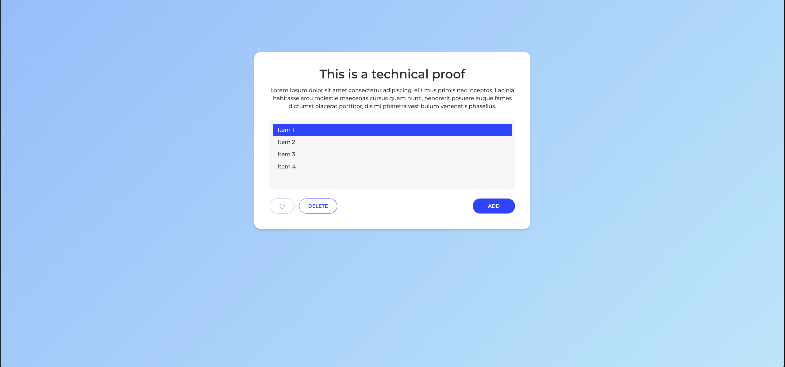
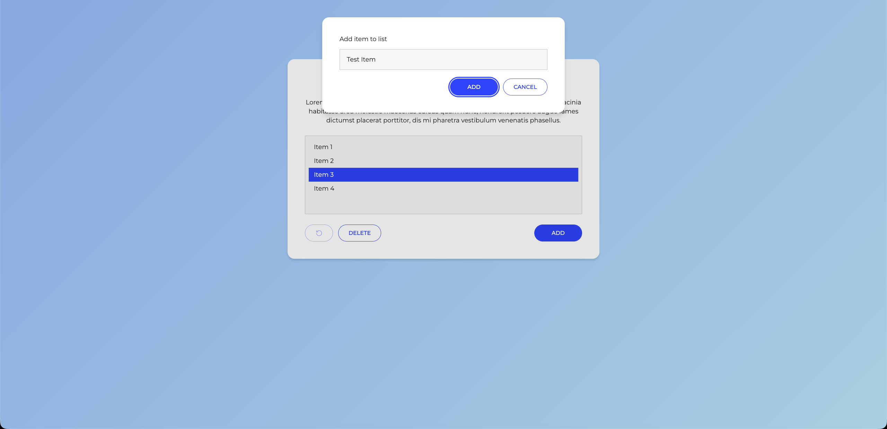

# Text List Manager

A front-end coding challenge implemented in **Vanilla JavaScript** and
**React 19 + TypeScript**, with the same functionality and shared styles.

## Preview




## Features

- Add entries through a modal, using the Add button or Enter.
- Reject empty or whitespace-only entries and trim surrounding whitespace.
- Disable Add during submission and guard against repeated form submissions.
- Select or deselect multiple items.
- Delete selected items, or remove an individual item with a double-click.
- Undo additions and deletions through the full session history.
- Close the modal with Cancel, Escape, or a click outside its content.

Delete is disabled when nothing is selected; Undo is disabled when the history
is empty. Data is kept in memory and resets when the page is reloaded.

## Getting started

### Requirements

- Node.js 24 or later
- pnpm 12.14.0, as specified in the root package

Run all commands from the repository root. Install dependencies for the whole
workspace once:

```bash
pnpm install
```

### Development

| Version | Command            | Default URL            |
| ------- | ------------------ | ---------------------- |
| Vanilla | `pnpm dev:vanilla` | http://127.0.0.1:3000/ |
| React   | `pnpm dev:react`   | http://localhost:5173/ |

Use the URL printed in the terminal if the default port is occupied. Press
Ctrl+C to stop the server. To compare both versions, run each command in a
separate terminal.

Vanilla uses ES modules; run it with `pnpm dev:vanilla` rather than opening the
HTML file directly.

### Type checking and build

```bash
pnpm typecheck
pnpm build
```

`typecheck` checks the React application, Vite configuration, and shared
Playwright configuration and tests in strict TypeScript mode. `build` checks
the React package and generates its production bundle in `react/dist/`,
including the shared stylesheet.

Vanilla has no runtime dependencies or build step. For static deployment, keep
the `vanilla/` and `shared/` directories alongside each other.

### React tests

Run tests from the repository root:

```bash
pnpm test:unit
pnpm test:unit:coverage
```

### End-to-end tests

Install Playwright's Chromium browser once after installing dependencies:

```bash
pnpm exec playwright install chromium
```

Run the shared browser tests against both React and Vanilla:

```bash
pnpm test:e2e
```

To run only one implementation:

```bash
pnpm test:e2e:react
pnpm test:e2e:vanilla
```

Playwright starts and stops its own React Vite server at
`http://127.0.0.1:4173/` and Vanilla static server at
`http://127.0.0.1:4174/vanilla/`. Keep both ports free; no separate development
servers are needed.
Browser tests live in [tests/e2e/](./tests/e2e/) and run separately from Vitest.
Each case runs once per implementation in Chromium. The configuration lives
in [playwright.config.ts](./playwright.config.ts), and failed tests retain
traces in `test-results/`.
For headed mode, run `pnpm test:e2e --headed`.

## Project structure

- [vanilla/](./vanilla/): HTML and JavaScript modules for state, rendering, and events.
- [react/src/](./react/src/): React components and the typed list-state hook.
- [tests/e2e/](./tests/e2e/): shared browser tests for React and Vanilla.
- [shared/styles.css](./shared/styles.css): shared layout, styles, and CSS design tokens.
- Root package: workspace commands and the Vanilla development server.

## Implementation notes

- **Independent implementations:** Vanilla uses DOM APIs; React uses components
  and a custom hook. They share CSS, not application logic.
- **State and undo:** additions and deletions save a snapshot of the items and
  their selection. Selection changes alone do not create history entries.
  Deleting an unknown ID does not create an entry either.
- **Item IDs:** both implementations use `crypto.randomUUID()` for initial
  and added items. IDs are strings and remain unchanged when undoing changes.
- **React list API:** `addItem` returns `void`, like the other list mutations.
  The form validates blank input before calling it and closes after completion,
  without relying on a boolean result.
- **Rendering:** Vanilla reuses list nodes to preserve focus and double-click
  behavior. Text is rendered with `textContent`; React uses its default escaping.
- **React components:** a reusable Button supports outline, primary, and icon
  variants while forwarding native button props and refs. Its `busy` prop
  disables interaction and shows a loading indicator with `aria-busy`, preserving
  the accessible name and button dimensions. The indicator respects reduced motion.
- **Form submission:** React uses a Form Action and `useFormStatus` to disable
  Add while pending through a small SubmitButton inside the form, plus a ref
  guard for repeated submit events. Vanilla
  disables Add and guards its synchronous submit handler with a flag.
  React displays submission errors and preserves the input for retrying.
  No artificial delays are introduced.
- **Vanilla callbacks:** event listeners and array callbacks use named
  functions to make their purpose and stack traces easier to identify.
- **Design:** CSS tokens group colors, typography, spacing, radii, shadows,
  dimensions, and motion durations/easing. Desktop measurements follow XD;
  smaller screens and enlarged text can expand the layout without fixing the
  card height.

## Accessibility

Both implementations include:

- **Keyboard support:** Tab reaches the controls and list items; Space or Enter
  toggles item selection.
- **Labels and states:** the input has an associated label, buttons have
  accessible names, and list items expose their selection through `aria-selected`.
- **Modal focus management:** the native `<dialog>` focuses the input, keeps
  focus out of the background, and returns it to Add when closed. Escape and
  Cancel dismiss the dialog.
- **Visible focus:** controls and list items use a primary-color focus ring.
  Placeholder text uses the body text color for readability.
- **Reduced motion:** focus and hover transitions do not move or resize
  controls and are disabled when `prefers-reduced-motion: reduce` is enabled.

### Known limitations

- The input border preserves XD's `#CCCCCC`, which falls below the 3:1
  non-text contrast threshold when unfocused.
- Listbox navigation uses Tab; arrow-key navigation is not implemented.

These features do not constitute a claim of full WCAG conformance.
